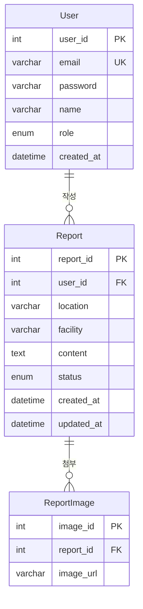

# 풍생고 1팀 ERD (최종본)

기준: `풍생고 1팀 명세서.md`

## 다이어그램

## 테이블 정의

표기: 테이블명 `영문 / 한글`, 컬럼은 `키 / 컬럼명 / 논리 이름 / Domain / Type` (비고에 제약조건)

### User / 유저

| 키 | 컬럼명 | 논리 이름 | Domain | Type | 비고 |
|---|---|---|---|---|---|
| PK | user_id | 유저 아이디 | - | int | AUTO_INCREMENT |
| UK | email | 이메일 | - | varchar(100) | NOT NULL, 학교 이메일(@ps.hs.kr), 로그인 ID |
| | password | 비밀번호 | - | varchar(255) | NOT NULL, 해시값 저장 (평문 금지) |
| | name | 이름 | - | varchar(50) | NOT NULL |
| | role | 권한 | - | enum('STUDENT','ADMIN') | NOT NULL, DEFAULT 'STUDENT' |
| | created_at | 가입일 | - | datetime | NOT NULL, DEFAULT now |

### Report / 신고

| 키 | 컬럼명 | 논리 이름 | Domain | Type | 비고 |
|---|---|---|---|---|---|
| PK | report_id | 신고번호 | - | int | AUTO_INCREMENT (순번) |
| FK | user_id | 유저 아이디 | - | int | NOT NULL, User.user_id 참조 (신고자) |
| | location | 장소 | - | varchar(100) | NOT NULL |
| | facility | 시설 | - | varchar(100) | NOT NULL |
| | content | 신고 내용 | - | text | NOT NULL |
| | status | 처리 상태 | - | enum('처리대기','처리중','처리완료') | NOT NULL, DEFAULT '처리대기' |
| | created_at | 신고일 | - | datetime | NOT NULL, DEFAULT now |
| | updated_at | 수정일 | - | datetime | NULL, 상태 변경 시각, ON UPDATE CURRENT_TIMESTAMP 설정 시 DB가 자동 갱신 |

### ReportImage / 신고 이미지

| 키 | 컬럼명 | 논리 이름 | Domain | Type | 비고 |
|---|---|---|---|---|---|
| PK | image_id | 이미지 아이디 | - | int | AUTO_INCREMENT |
| FK | report_id | 신고번호 | - | int | NOT NULL, Report.report_id 참조, ON DELETE CASCADE |
| | image_url | 이미지 경로 | - | varchar(500) | NOT NULL |

사진은 필수가 아니므로, 사진 없는 신고는 이 테이블에 행이 없음.

## 관계

- User 1 : N Report — 한 사용자가 여러 신고를 작성
- Report 1 : N ReportImage — 한 신고에 사진 여러 장 (0장 가능)

## 설계 결정

- 학생/관리자는 User 테이블 하나에 `role`로 구분
- 로그인은 JWT 방식이라 세션 테이블 없음
- 장소/시설은 관리자 관리 페이지가 없으므로 마스터 테이블 없이 문자열로 저장
- 상태 변경 이력 테이블 없음, `status` + `updated_at`만 사용
- DB는 MySQL 사용. 날짜는 `datetime`으로 통일 (시간대 변환 없음, 2038년 제한 없음)
